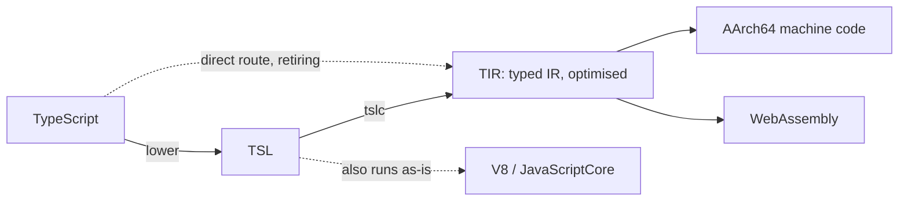

# TSL-TMK

A compiler from TypeScript to machine code, and a capability microkernel to be written with it. A side project, and a work in progress.

- **TSL** is a strict subset of TypeScript with exact-size numbers (`u8`, `i32`, `f64`, ...), plain and layout classes, and references the runtime checks. Every TSL file is also legal TypeScript, so it type-checks with `tsc` and runs on V8 and JavaScriptCore.
- **Ordinary TypeScript** is compiled by lowering it into TSL first. The lowering desugars into plain, readable TSL rather than extending the language. The printed TSL is itself legal TypeScript, which gives an independent check: the source, the printed TSL, and the native build must all agree.
- **TMK** is the microkernel: capabilities, user-space drivers and portable designs. It hasn't been started yet; the compiler comes first.

[SPEC.md](SPEC.md) is the single entry point for the design, and [decisions.md](decisions.md) logs each decision with its reasons and the options rejected.

## Pipeline



There are still two routes from TypeScript: the TSL route, and an older direct route (dotted) that lowers straight to TIR. Programs move to the TSL route only when it is no slower than the direct route at `-O1` and `-O2`. The direct route is retired once everything has moved.

## Memory modes

| Mode | What it means |
|---|---|
| `strict` / `noStd` | No heap behind the program's back. This is what the kernel uses. |
| `leak` | Allocate and never free, for short-lived programs and arenas. |
| `manual` | Explicit freeing, checked at run time. |
| `rc` | Reference counting (`Rc` from `@tsl/gc`) with a cycle collector and a bounded amount of freeing per allocation, so there are no collection pauses. |

## Targets

- **Bare-metal AArch64 images**, run under QEMU with Apple's virtualisation (HVF), or with emulation (TCG) as the backup. This is the kernel's target and the main test target.
- **macOS on Apple Silicon** (Mach-O, phase 1): native executables linked with the system `ld` against libSystem. Their output is identical to the QEMU target's across the corpus.
- **WebAssembly**, for a subset.

## Status

- The compiler runs TSL and ordinary TypeScript natively in every memory mode, with an optimiser at `-O0`, `-O1` and `-O2`.
- Typical code runs at about 1.18× the speed of clang-compiled C (median of the S4 suite).
- Most of the corpus now goes through the TSL route. The remaining gaps are listed in `decisions.md`.
- The compiler is not self-hosted yet. It runs on Node and uses the `typescript` package. A self-hosted `tslc` written in TSL is milestone M8.

## Getting started

Needs macOS on Apple Silicon, Node 25 or newer, pnpm, and QEMU (`brew install qemu`).

```sh
pnpm install
node tools/tmk.ts doctor                 # checks Node, QEMU, HVF and the guards
node tools/tmk.ts compile corpus/pos/fib_rec.ts --target macos-arm64 --out fib && ./fib
node tools/tmk.ts lower <file.ts> --memory rc --target macos-arm64 --out prog
node tools/tmk.ts test --changed         # runs only the tests your edits can reach
node tools/tmk.ts test                   # the quick tier, a few minutes
```

Run `node tools/tmk.ts` with no arguments to see every command. **`tmk gate` starts a full verification run of the whole suite (about 1.5 hours).** `tmk gate --help` and `tmk test --help` print their usage and start nothing.

## Layout

| Path | What's there |
|---|---|
| `compiler/host` | The lowering from TypeScript, the TSL printer and `tslc`'s front end |
| `compiler/tir` | The typed IR and its optimiser |
| `compiler/backend-aarch64` | Code generation, bare-metal images and Mach-O objects |
| `compiler/rt` | The runtime used by the direct route |
| `packages/` | The TSL libraries: `@tsl/core`, `@tsl/std`, `@tsl/gc`, `@tsl/jsrt` (JS-style arrays, strings, maps), `@tsl/alloc`, `@tsl/unsafe`, `@tsl/lowered`, `@tsl/arch-aarch64` |
| `corpus/` | Test programs with their expected results |
| `bench/` | Benchmarks, including a JPEG decoder |
| `tools/` | The `tmk` CLI and the test harness |
| `design/` | Design notes |

## Licence

None yet: all rights reserved for now. Code derived from other projects is listed in [THIRD_PARTY](THIRD_PARTY) with the notice each one requires.
